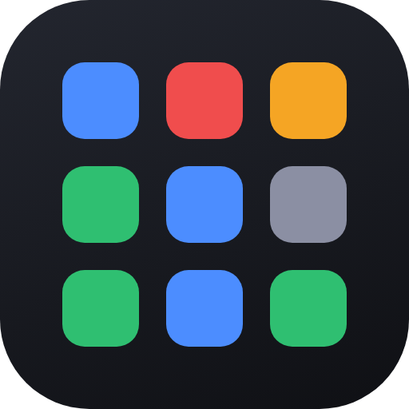
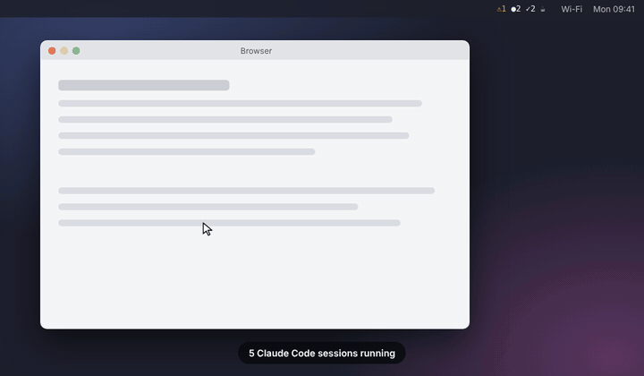
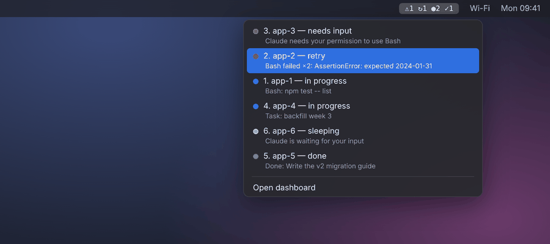
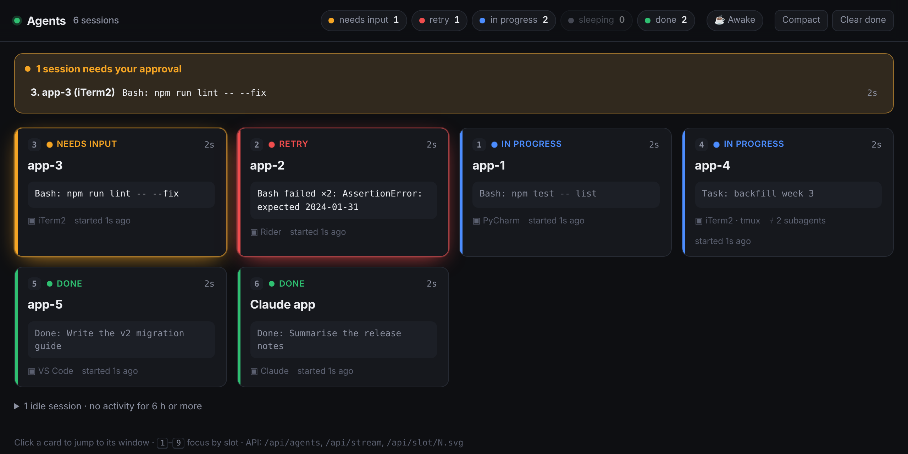
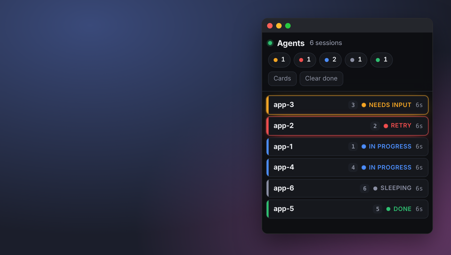
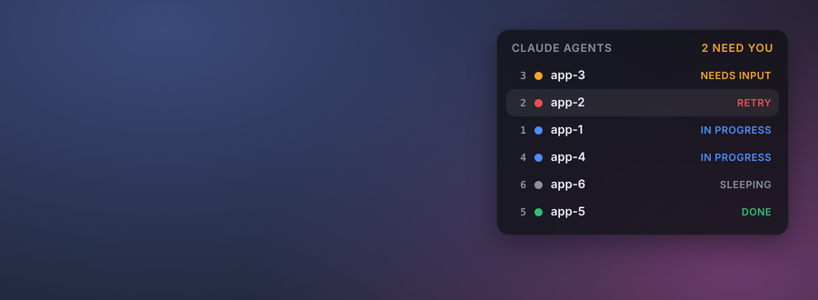
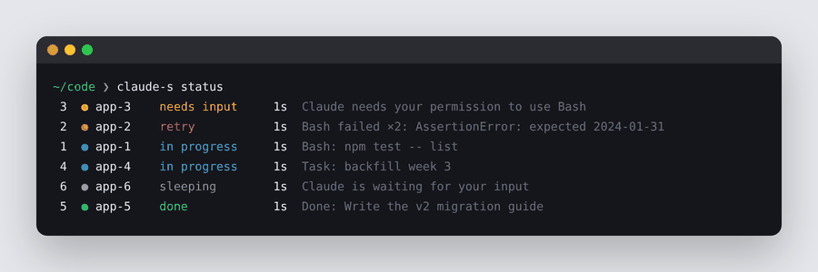
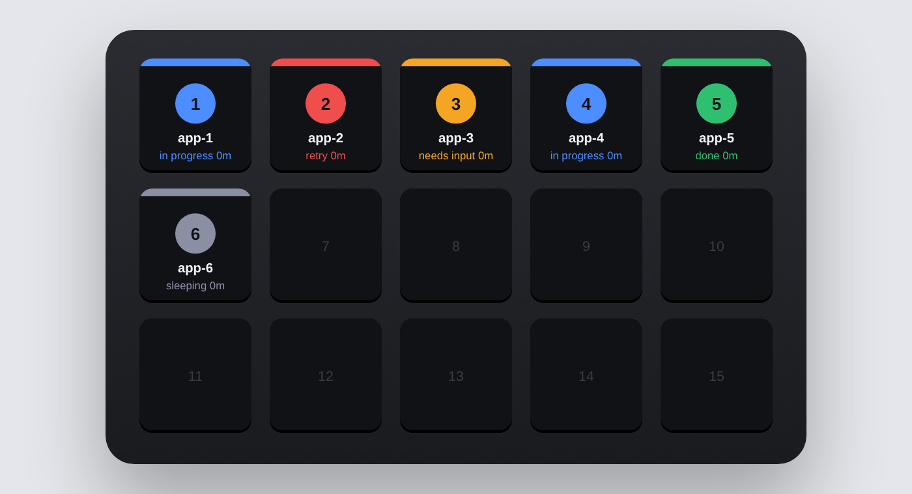

<p align="center">
  
</p>

<h1 align="center">Agent Status for Claude Code</h1>

<p align="center">
  A Claude Code plugin that shows all your running sessions in one place: which ones need your approval,<br>
  which are working and which are done. Click one and you're back in its terminal tab or IDE window,<br>
  and your agents keep working while your Mac is locked.
</p>

<p align="center">
  <a href="https://github.com/mk-quantlabs/claude-agent-status/actions/workflows/ci.yml"></a>
  <a href="https://github.com/mk-quantlabs/claude-agent-status/releases"></a>
  <a href="LICENSE"></a>
  
  
</p>

<p align="center">
  
</p>

- **See every session at once**: in progress, needs approval, retry or done, across all your terminals and IDEs
- **Jump to any session** with one click: the exact iTerm2 / Terminal tab, or the right IDE window
- **Know when an agent needs you**: approval requests show up everywhere, even as a notification on the lock screen
- **Agents keep working while your Mac is locked**: no idle sleep while an agent is working; normal sleep returns when they're done

---

## Quick start

macOS, with [Claude Code](https://code.claude.com) and Node.js 18+ installed:

```bash
git clone https://github.com/mk-quantlabs/claude-agent-status.git ~/claude-agent-status
~/claude-agent-status/install.sh
```

The installer adds the plugin to Claude Code, so you keep starting Claude the usual way:

```bash
claude
```

That's it: every session shows up in the menu bar. The plugin loads straight from this folder, so `git pull` updates it.

> Keep the folder in your home directory, not in `~/Documents`, `~/Desktop` or `~/Downloads`. macOS can stop apps like IDE terminals from reading those folders, and sessions started there won't show up.

## Statuses

| | Status | When |
|---|---|---|
| 🟠 | **needs input** | Claude is waiting for your approval or answer (see [Approval alerts](#approval-alerts)) |
| 🔴 | **retry** | Two or more tool failures in a row, or an API error |
| 🔵 | **in progress** | Working on your prompt |
| ⚪ | **sleeping** | New session, idle, or no activity for 3+ minutes |
| 🟢 | **done** | Finished its answer and is waiting for the next prompt |

Sessions disappear from the board as soon as their Claude process exits. Agents that need you (🟠 🔴) are always listed first.

## Approval alerts

When a session asks for permission, every surface shows it, together with what it wants to run and how long it has been waiting:

- **Menu bar**: the title turns orange and starts with `⚠ N`; a **Needs your approval** section sits at the top of the menu.
- **Dashboard and compact window**: an orange banner lists the sessions; the browser tab shows `(N) Approval needed`.
- **Desktop widget**, **`claude-s status`** and **Stream Deck keys** (`APPROVE?`) show the same list.
- **macOS notification** when a session starts waiting, also on the lock screen. Turn it off with `claude-s notifications off`.

Agent Status never approves anything. Clicking a session only brings its window to the front, so you answer it there.

## Keep awake while agents work

Locking the screen doesn't stop your agents; the Mac going to sleep does. While at least one agent is working, Agent Status keeps the Mac from idle sleep with macOS's built-in `caffeinate`. The display can still turn off and the screen still locks, and the agents keep running behind the lock screen. One minute after the last agent stops working, normal sleep returns.

The menu bar shows `☕` while the Mac is kept awake. Change the mode with:

| Command | Mode |
|---|---|
| `claude-s awake always` | Keep awake while agents work, on battery too (default) |
| `claude-s awake power` | Only while on the power adapter |
| `claude-s awake off` | Never |
| `claude-s awake` | Show the current mode and state |

Closing the lid on battery still puts the Mac to sleep.

## Where you can see it

### Menu bar (default)

Counts sit in the menu bar: ⚠ needs approval, ↻ retry, ● in progress, ✓ done, ☕ keeping the Mac awake. Sessions that need approval are listed first; each agent is one row: hover it for details, click it to jump to it. The menu only shows status: clicking a session is the only action, besides opening the dashboard. The last line shows the keep-awake state. `install.sh` sets this up using the free [SwiftBar](https://swiftbar.app) app.



### Web dashboard

Run `claude-s open`, or go to **http://127.0.0.1:4317**. Each card shows the project, git branch, current tool or prompt, number of subagents and time in the current status. Use keys `1`–`9` to jump by slot. Follows your system's light or dark mode.



### Compact window

`claude-s compact` opens a small app window you can keep at the side of your screen.



### Desktop widget

`claude-s widget` adds a widget to your desktop using the free [Übersicht](https://tracesof.net/uebersicht/) app.



### Terminal

`claude-s status` prints the board in your terminal.



### Stream Deck (API ready)

Each agent gets a stable slot number, and the daemon serves a ready-made key image and a focus action for every slot. A native Stream Deck plugin isn't included yet. See the [API](#api) section below to wire it up yourself.



## Click to jump to the session

A click only brings the session's existing window to the front. It never opens or launches anything: no project, folder, window or app.

| Where the session runs | What a click does |
|---|---|
| **iTerm2** | Focuses the exact tab or split |
| **Terminal.app** | Focuses the exact tab |
| **tmux** (any terminal) | Switches to the exact window and pane |
| **JetBrains IDEs** (Rider, PyCharm, IntelliJ IDEA, WebStorm, GoLand…) · *beta* | Brings up the project the session belongs to, whether projects are separate windows or tabs of one window. If it picks the wrong project, please [open an issue](https://github.com/mk-quantlabs/claude-agent-status/issues) with the output of `claude-s debug` |
| **VS Code, Cursor, Windsurf** | Raises that project's window |
| **WezTerm, kitty** | Focuses the pane or window, if the app's CLI is available |
| Ghostty, Warp, others | Raises the project's window, or brings the app to the front |

The app is detected from the process tree, so it works even when an IDE was launched from a terminal.

**macOS permissions.** Menu-bar clicks run inside SwiftBar, so the permissions belong to SwiftBar, whichever terminal your sessions run in:
- **Automation**: on the first click, macOS asks to let SwiftBar control iTerm2, Terminal or System Events. Click **OK**.
- **Accessibility**, needed for IDEs (JetBrains, VS Code…): lets SwiftBar raise the right project window. Go to System Settings → Privacy & Security → Accessibility and turn on SwiftBar.

If a click doesn't switch windows, run `claude-s debug`. It shows where each session was recorded and every step of the last clicks, with the exact error.

## The `claude-s` command

`claude-s` holds the helper commands: status, keep-awake, diagnostics. You can also start sessions with it: it starts the background service and the menu-bar icon, then runs `claude`, adding the plugin only if it isn't installed in Claude Code. Put options before your Claude arguments; anything after `--` is passed to `claude` unchanged.

| Command | What it does |
|---|---|
| `claude-s` | Start Claude with the status board |
| `claude-s dashboard` | Also open the dashboard |
| `claude-s compact` | Also open the compact window |
| `claude-s widget` | Also install the desktop widget (one time) |
| `claude-s menubar` | Also reinstall the menu-bar icon |
| `claude-s -- --resume` | Pass `--resume` (or any other flag) to Claude |
| `claude-s status` | Show the board in the terminal |
| `claude-s focus 3` | Jump to the agent in slot 3 |
| `claude-s open` | Open the dashboard only |
| `claude-s awake [always\|power\|off]` | Show or set the keep-awake mode |
| `claude-s notifications on\|off` | Turn approval notifications on or off |
| `claude-s doctor` | Check the setup and macOS permissions |
| `claude-s debug` | Show where each session runs and what the last clicks did, with exact errors |
| `claude-s restart` / `stop` | Restart or stop the background service |
| `claude-s demo` | Try the board with fake agents |
| `claude-s help` | List all commands |

You can combine options, for example `claude-s dashboard compact`. Add `--no-claude` to run the actions without starting Claude.

## Install options

**Without the menu bar:**
```bash
~/claude-agent-status/install.sh --no-menubar
```
Or turn it off later by adding `export AGENT_STATUS_MENUBAR=0` to `~/.zshrc`.

**Without installing the plugin in Claude Code:**
```bash
~/claude-agent-status/install.sh --no-plugin
```
Then start sessions with `claude-s`, which loads the plugin for that session only.

**Plugin from GitHub instead of your local folder** (gets what's released on `main`; update with `claude plugin marketplace update agent-status`):
```bash
claude plugin marketplace add mk-quantlabs/claude-agent-status
claude plugin install agent-status@agent-status
```

**Manual setup, without the installer:**
```bash
claude plugin marketplace add ~/claude-agent-status
claude plugin install agent-status@agent-status
echo "alias claude-s='~/claude-agent-status/bin/claude-s'" >> ~/.zshrc
```

**Turn the plugin off for a while:** `claude plugin disable agent-status@agent-status` (and `enable` to turn it back on).

**Try it without Claude:**
```bash
~/claude-agent-status/bin/claude-s demo
```

**Uninstall:**
```bash
~/claude-agent-status/uninstall.sh && rm -rf ~/claude-agent-status
```

## How it works

```
Claude Code sessions ──hooks──▶ local service (127.0.0.1:4317) ──▶ menu bar · dashboard · widget · terminal
                                                              └──▶ JSON / live stream ──▶ Stream Deck, your own tools
```

1. The plugin registers [Claude Code hooks](https://code.claude.com/docs/en/hooks) for prompt submission, tool use, notifications, stop and session end. Each hook sends a small JSON event to the local service. Hooks never block Claude: they have a short timeout and always exit cleanly.
2. The service turns those events into a status for each session. It also records where the session runs (terminal app, tab, tmux pane, IDE) so a click can bring you back to it.
3. Every few seconds it checks that each session's Claude process is still alive and drops the ones that have exited.

No dependencies beyond Node.js. The service listens on `127.0.0.1` only and rejects requests sent with any other host name.

## API

| Endpoint | Purpose |
|---|---|
| `GET /api/agents` | All agents, counts per status, pending `approvals`, `keepAwake` state and `config` |
| `GET /api/stream` | Server-sent events, pushed on every change |
| `GET /api/slot/N` | One slot as JSON |
| `GET /api/slot/N.svg` | 144×144 key image for slot N |
| `POST /api/slot/N/focus` | Focus the agent in slot N |
| `POST /api/agents/:id/focus` | Focus an agent by session id |
| `POST /api/agents/:id/dismiss` | Remove an agent from the board |
| `POST /api/clear` | Clear agents by status, e.g. `{"statuses":["done"]}` |
| `GET /api/swiftbar` | Menu text in SwiftBar / xbar format |
| `GET /api/config` | Settings: `keepAwake` (`always` · `power` · `off`), `systemNotifications` (`true` · `false`) |
| `POST /api/config` | Change settings, e.g. `{"keepAwake":"power"}`; saved to `config.json` |

POST requests must use `Content-Type: application/json`.

## Configuration

Settings changed with `claude-s awake`, `claude-s notifications` or the menu are saved in `~/.claude/agent-status/config.json`.

These environment variables are read when the service starts:

| Variable | Default | |
|---|---|---|
| `AGENT_STATUS_PORT` | `4317` | Port of the local service |
| `AGENT_STATUS_STALL_MIN` | `3` | Minutes without activity before a working agent counts as sleeping |
| `AGENT_STATUS_MENUBAR` | `1` | Set to `0` to stop `claude-s` from setting up the menu bar |
| `AGENT_STATUS_DIR` | `~/.claude/agent-status` | Where session state is kept between restarts |

## Troubleshooting

Run `claude-s doctor` first. It checks the setup, restarts the service, tests the macOS permissions and opens the right System Settings page for anything that's missing.

- **A session doesn't show up.** Check that the plugin is enabled (`claude plugin list`), or start the session with `claude-s`; then send it a prompt. If it was started from an IDE terminal, check that the folder isn't in `~/Documents`, `~/Desktop` or `~/Downloads` (see Quick start).
- **The menu bar shows `◌`.** The service isn't running. It starts with the next `claude-s`, or run `claude-s restart`.
- **A click doesn't switch windows.** Run `claude-s debug` and look at the ✗ step. `not authorized` or `-1743` means SwiftBar needs the Automation or Accessibility permission (see [Click to jump to the session](#click-to-jump-to-the-session)). Sessions started before an update record their window on the next prompt.
- **Status looks wrong.** `claude-s restart` resets the service. Live sessions reappear after their next event.

## Limitations

- Keep awake can't prevent sleep when the lid is closed on battery power.
- Shows Claude Code sessions on this computer only. Cloud sessions and claude.ai chats don't run local hooks.
- Claude Code has no "retry" event, so **retry** is inferred from repeated tool failures.
- JetBrains support is in beta: with several projects open, the click may not always land on the right project.
- In JetBrains IDEs and VS Code, a click switches to the right project window, but it can't select a specific terminal tab inside the IDE. For exact-tab jumps, run sessions in iTerm2, Terminal or tmux.
- The menu bar and desktop widget are macOS-only. The dashboard, terminal view and tmux focus also work on Linux.

## FAQ

### How do I see all my running Claude Code sessions at once?
Install Agent Status. Every Claude Code session reports its state through hooks, and the menu bar lists each one as needs approval, retry, in progress, sleeping or done. `claude-s open` shows the same in a local web dashboard, and `claude-s status` in the terminal.

### How do I get notified when Claude Code needs permission?
Agent Status sends a macOS notification the moment a session starts waiting for approval, also on the lock screen, and lists waiting sessions first on every surface, with the command they want to run. Turn the notification off with `claude-s notifications off`.

### How do I switch between multiple Claude Code sessions quickly?
Click a session in the menu bar or dashboard. It brings that session's existing iTerm2 or Terminal tab, tmux pane, or IDE window to the front. It never opens a new window or types anything.

### How do I keep my Mac awake while Claude Code is running?
Agent Status does it for you: while at least one agent is working, it holds macOS's `caffeinate` so the Mac doesn't idle-sleep, and releases it one minute after work stops. Choose when with `claude-s awake always|power|off`.

### Does Claude Code keep working when my Mac is locked?
Yes. Locking never stops it; sleep does. While an agent works, Agent Status keeps the Mac from idle sleep, so you can lock it and walk away. Closing the lid on battery still sleeps the Mac.

### Does it work with VS Code, Cursor or JetBrains IDEs (PyCharm, IntelliJ IDEA, Rider)?
Yes. Sessions in any terminal or IDE show up. A click raises the right project window in VS Code, Cursor, Windsurf and JetBrains IDEs (JetBrains is beta), but it can't select a terminal tab inside the IDE.

### Can I approve a request from the menu bar?
No, by design. A click only takes you to the session; you answer it there.

### Does it drain my battery?
Only while agents are working, and for one minute after. `claude-s awake power` keeps the Mac awake only on the power adapter; `claude-s awake off` turns it off.

### Which sessions show up?
Claude Code sessions running on this Mac, from any terminal or IDE, once the plugin is installed. Cloud sessions and claude.ai chats run elsewhere and can't be seen.

### Do I have to use `claude-s`?
No. After `install.sh`, plain `claude` reports its status. `claude-s` is for the helper commands.

### Does it send any data anywhere?
No. The service listens on `127.0.0.1` only, keeps its state in `~/.claude/agent-status` and makes no network requests.

## Contributing

Issues and pull requests are welcome; see [CONTRIBUTING.md](CONTRIBUTING.md). Ideas for what's next:

- A native Stream Deck plugin with live key colors
- Precise tab focus for Ghostty, Warp and IDE terminals
- Windows support for click-to-focus
- Notifications on Linux


## License

[MIT](LICENSE)

---

*Not affiliated with Anthropic. Claude and Claude Code are trademarks of Anthropic.*
